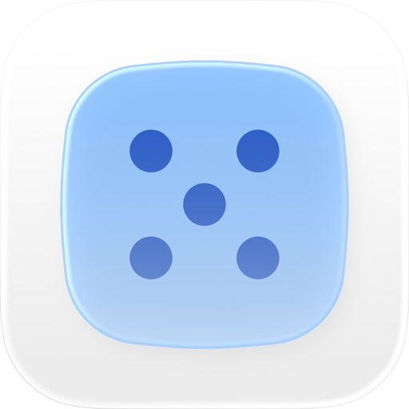
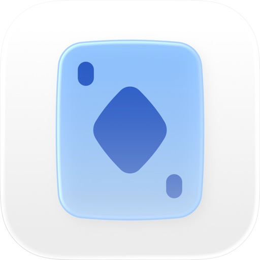

# Hi, I'm Weixuan Sun 👋

**Computer Engineering student focusing on Cybersecurity, Networks, and iOS Development based in Madrid.**

I'm a fourth-year Computer Engineering student at **Universidad Carlos III de Madrid (UC3M)**. Beyond the classroom, I am deeply driven by hands-on engineering: managing and hardening self-hosted server infrastructure exposed to the internet, and designing, developing, and publishing apps on the App Store. I love exploring how systems communicate, ensuring their security, and building reliable software from the ground up.

## 📱 Apps I've built

<table>
  <tr>
    <td width="96" align="center" valign="middle">
      
    </td>
    <td>
      <h3><a href="https://pixelstime.com">PixelsTime</a></h3>
      
Make everyday decisions with spinning wheels, coin flips, and random picks.

      
iOS · Released in February 2026 after two years of development.

    </td>
  </tr>
  <tr>
    <td width="96" align="center" valign="middle">
      
    </td>
    <td>
      <h3><a href="https://muscounter.com">MusCounter</a></h3>
      
Keep score in Mus with custom scoring rules, point history, and saved matches.

      
iOS · Released in September 2026 after one year of development.

    </td>
  </tr>
</table>
